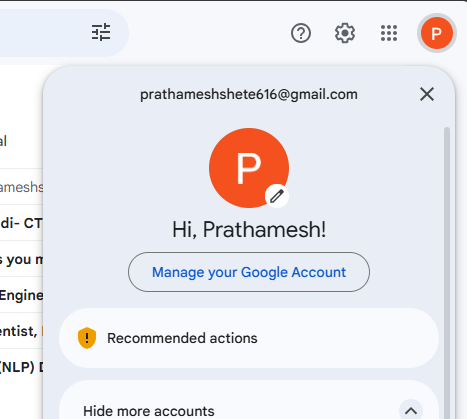

# Bulk Email Sender

A simple and user-friendly Streamlit application to send bulk emails (with attachments) using Gmail's SMTP server.

---

## Demo



---

## Features

- Send personalised emails to multiple recipients from a CSV file.
- Downloadable template CSV for first-time users.
- Placeholders like `[Recruiter Name]`, `[Company]`, `[Role]` filled per recipient.
- Blank or messy cells fall back to sensible defaults (e.g. "Dear Hiring Manager").
- Skip your current company: type its name (or domain) and matching contacts are not emailed.
- Review/edit the contact table, preview each email, and send a test email to yourself.
- Schedule sending for a later date and time.
- Progress bar, delay between emails, and a downloadable send report.
- Attach multiple files to each email.
- Simple web interface built with Streamlit.
- Uses Gmail App Password for secure authentication.

---

## Prerequisites

- Python 3.7 or higher
- A Gmail account with [App Password](https://support.google.com/accounts/answer/185833?hl=en) enabled
- Less secure app access is **not** required (App Password is safer)

---

## Installation

1. **Clone the repository:**
   ```sh
   git clone https://github.com/demo-user/bulk-email-sender.git
   cd bulk-email-sender
   ```

2. **Install dependencies:**
   ```sh
   pip install -r requirements.txt
   ```

---

## Usage

1. **Start the Streamlit app:**
   ```sh
   streamlit run app.py
   ```

2. **Open the app** in your browser (usually at [http://localhost:8501](http://localhost:8501)).

3. **Fill in three things and send:**
   1. Your **Gmail address** and **App password**.
   2. Upload your **contacts CSV** and **resume** (optionally type your current company to skip it).
   3. Check the preview, then click **Send**. Use **Test to myself** first if you like.

   To send later, switch **Send now** to **Schedule**, pick a date and time (in your timezone) and click
   **Schedule**. You can close the tab; status, cancel and the report appear under step 1. The app must keep
   running until then (keep the terminal open and the laptop awake when running locally); a restart drops the job.

   Optional sections (collapsed by default): *Review recipients*, *Edit email text*, *Settings* (fallbacks, delay).

4. **Skip typing every time (local only):** copy `.streamlit/secrets.toml.example` to `.streamlit/secrets.toml`
   and fill in your Gmail, app password and current company. The app pre-fills them. This file is git-ignored.

---

## CSV File Format

Click **Template CSV** in the app (or use [`templates/contacts_template.csv`](templates/contacts_template.csv)):

```
Email,Contact Person,Company,Role / Job,Subject,Message
priya.sharma@example.com,Priya Sharma,Example Technologies,AI/ML Engineer,,
hr@example.org,,Example Labs,Data Scientist,,
rahul.verma@example.net,Rahul Verma,,GenAI Engineer,Quick question about the [Role] opening,"Hi [First Name], ..."
```

- Only **Email** is required; other cells may be blank.
- **Subject** and **Message** are optional: fill them to write a custom email for that row (placeholders work).
  Leave them blank to use the default subject/body from the app. For line breaks, press Alt+Enter in Excel /
  Google Sheets, or type `\n`.
- Any extra column (e.g. `Phone`) can be used as a `[Phone]` placeholder.
- A plain list of emails without a header (like [`email.csv`](email.csv)) still works.

### Placeholders and fallbacks

| Placeholder | Column | Used when blank |
|---|---|---|
| `[Recruiter Name]` | Contact Person | Hiring Manager |
| `[First Name]` | Contact Person (first word) | Hiring Manager |
| `[Company]` | Company | your organization |
| `[Role]` | Role / Job | AI/ML Engineer roles |
| `[Email]` | Email | – |

Fallbacks can be changed in the app. Values are also cleaned: emojis and hashtags are removed, ALL-CAPS text is softened,
a Company equal to the Contact Person is treated as blank, and a name repeated across 3+ different email domains
is treated as unreliable and replaced with the fallback.

The default email body lives in [`templates/email_template.txt`](templates/email_template.txt).

---

## Example

Suppose you want to send a welcome email with a PDF attachment to three users:

- **Sender Email:** `demo.sender@gmail.com`
- **App Password:** `abcd efgh ijkl mnop`
- **Subject:** `Welcome!`
- **Body:** `Hi there, welcome to our service. Please find the attached document.`
- **CSV:**  
  ```
  user1@example.com
  user2@example.com
  user3@example.com
  ```
- **Attachment:** `welcome.pdf`

After filling these in and clicking "Send Emails", each user will receive the email with the attachment.

---

## How to Create a Gmail App Password

1. Go to your [Google Account Security page](https://myaccount.google.com/security).
2. Enable 2-Step Verification.
3. Under "Signing in to Google", select **App passwords**.
4. Generate a new app password for "Mail" and "Other (Custom name)".
5. Copy the 16-character password (remove spaces when entering in the app).

For a detailed guide with screenshots, click the "How to create App Password" button in the app or see [`pages/app_passwords.py`](pages/app_passwords.py).

---

## Security Note

- **Never use your main Gmail password.** Always use an App Password.
- App Passwords can be revoked at any time from your Google Account.

---

## License

MIT License

---

## Author

Developed by [Demo User](https://github.com/demo-user)
